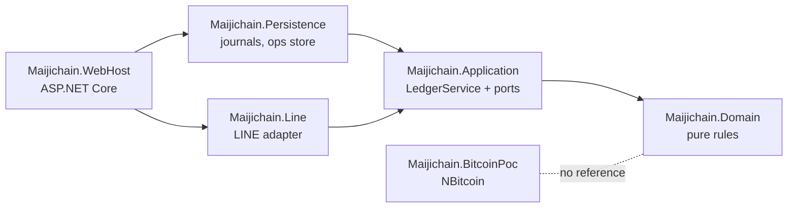

# Architecture

## Projects and dependency rules

| Rule | Why | Enforced by |
|---|---|---|
| Domain references only the base class library | Rules stay pure, fast and deterministic | `ArchitectureTests.Domain_depends_only_on_the_base_class_library` |
| Application knows nothing about LINE or files | Storage and chat surface are replaceable | `ArchitectureTests.Application_does_not_know_about_line_or_files` |
| No ledger assembly references NBitcoin | The chain can never corrupt the expense record (principle 5) | `ArchitectureTests.Ledger_side_assemblies_never_reference_bitcoin` |
| The POC references no Maijichain assembly | The POC cannot write to the ledger (FR-BTC-11) | `ChainTrackerTests.Poc_assembly_cannot_reach_the_ledger` |

## Key decisions

**Event sourcing with one record per command.** `GroupLedger` validates a command and returns a `Decision`.
`LedgerService` appends the event, fsynced, and only then applies it to memory. Replay runs the same `Apply` code and
re-checks every posting, so a hand-edited journal is detected instead of silently trusted. Reads, explanations, periods
and plan staleness are all projections of the same event list.

**Three layers of idempotency.**
1. Ingress: a unique `webhookEventId` in the inbox. Redelivery is acknowledged and dropped.
2. Command: each command carries its event ID as `SourceKey`. Re-processing after a crash returns the original event.
3. State: confirming an already-posted draft or payment is a no-op. This is what catches two taps on "Confirm", which
   are two different events.

**Outbox with cost awareness.** Replies are free; pushes cost one message per group member. The dispatcher replies
while the token is fresh. After that it pushes only financially important messages, within a monthly budget, using a
deterministic `X-Line-Retry-Key`.

**Privacy by construction.** LINE user and chat IDs are HMAC-hashed with a server pepper before they reach the ledger.
Webhook payloads are purged from the operations store by compaction. Logs carry IDs and outcomes only. Each of these
has an automated test.

**Exact netting where it is cheap.** For at most 20 unsettled members, a 2^k subset dynamic program finds the
maximum partition into zero-sum groups, which gives the provably minimal number of transfers. Above that, the greedy
heuristic runs and the plan says so.

**Storage without a server.** Each group has one append-only JSON-lines journal with per-line SHA-256 checksums. A final
line without its newline (a crash mid-write) is discarded and overwritten; any other checksum failure stops the load.
This suits a single instance serving one friend group. To scale out, implement `IEventJournal` and `IOperationsStore`
on a database with a unique index on the idempotency keys.

## Runtime flow

1. `POST /webhooks/line` reads the raw body (≤ 1 MiB) and verifies the HMAC in constant time. Each event goes to the
   inbox and is fsynced, then the endpoint returns 200.
2. `InboxWorker` takes pending events in event-timestamp order and calls `LineEventProcessor`.
3. The processor parses `/commands` (anything else is ignored), resolves the member and runs one ledger command. It then
   queues one reply in the outbox.
4. `OutboxWorker` delivers by reply, or by budgeted push for important messages.
5. A poison event is retried 5 times, then marked failed and logged by event ID.
