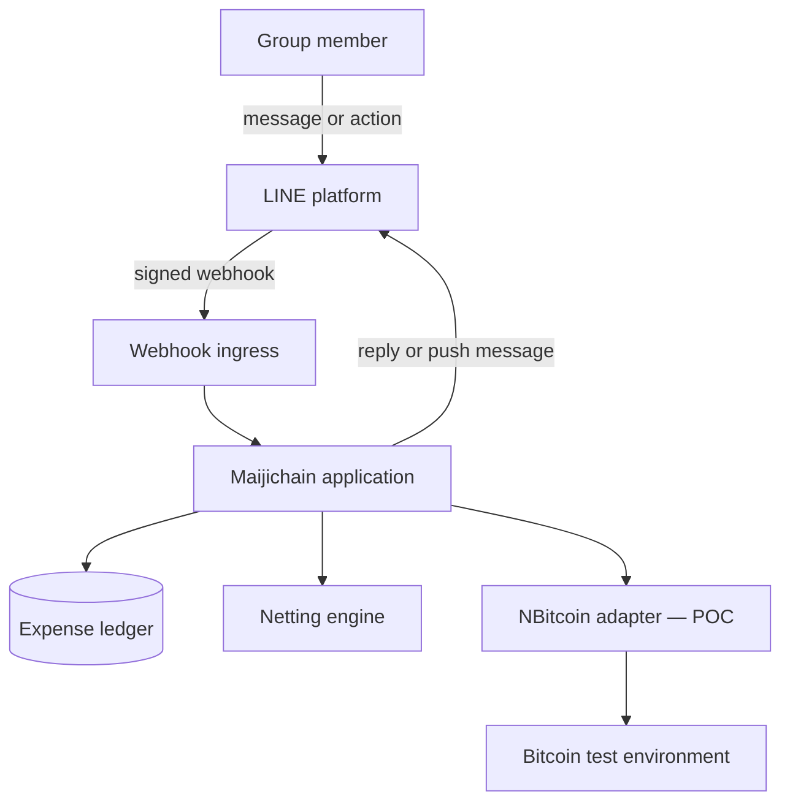
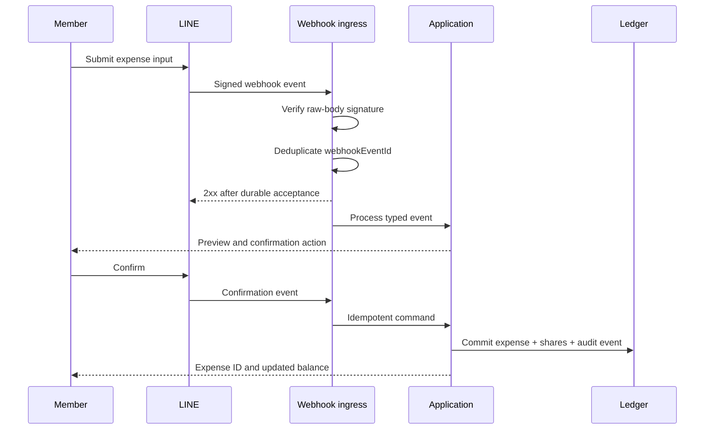
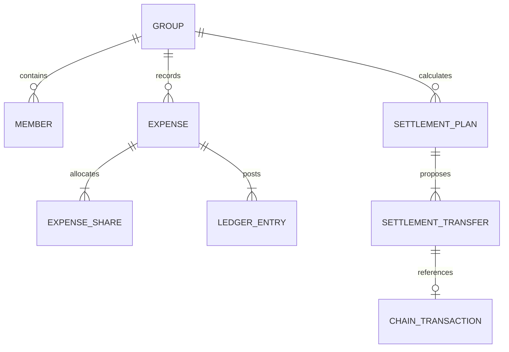
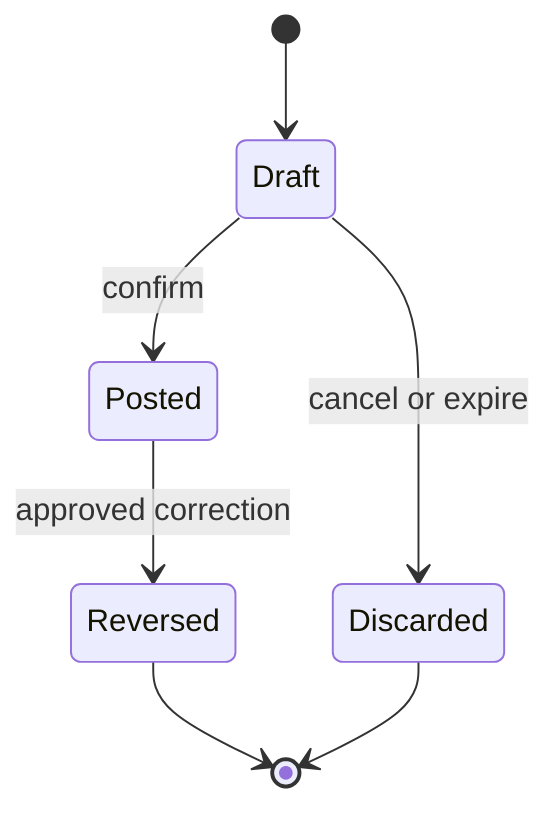
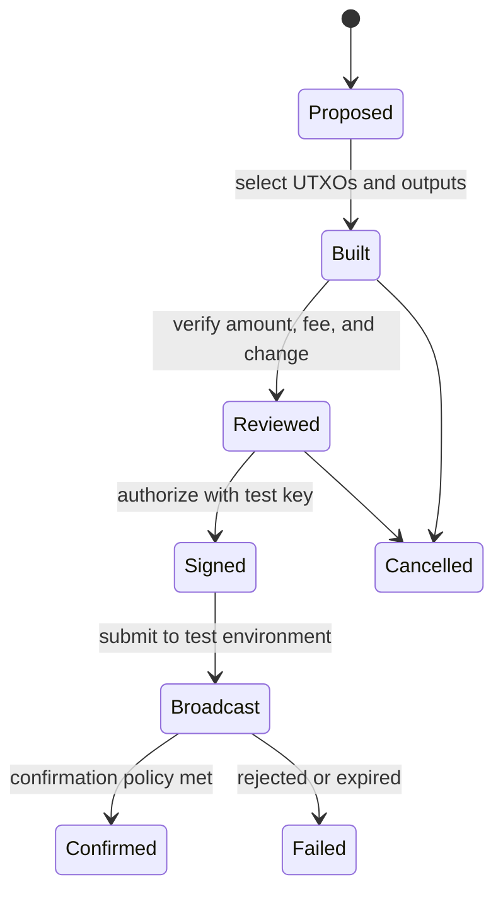

# Maijichain

## User Requirements and Functional Specification

| Field | Value |
|---|---|
| Document version | 0.9 — portfolio draft |
| Product | Maijichain shared-expense application |
| Technology | C#, LINE Messaging API, NBitcoin |
| Operating context | Private 11-person group |
| Evidence supplied | More than three years of recurring use; 150 transaction cases evaluated |
| Intended audience | GitHub visitors, maintainers, and graduate admissions reviewers |

> **Scope and evidence note**  
> This document separates the working shared-expense application from the Bitcoin experiment. The LINE-integrated expense ledger and balance-netting logic are the operating product described by the project owner. Bitcoin transaction functionality is a separate proof of concept on a test network. Items marked **Hardening target** are design improvements, not claims about the historical implementation.

### Status legend

| Label | Meaning |
|---|---|
| **Confirmed** | Supported by the project facts currently available |
| **POC** | Explored in the NBitcoin/Bitcoin test-network prototype |
| **Hardening target** | Recommended requirement for a production-quality redesign |
| **To confirm** | Requires source code, screenshots, or owner confirmation before it should be claimed publicly |

---

## 1. GitHub-ready project summary

Maijichain is a C# shared-expense application built for a private 11-person group. It turns expense inputs received through LINE into an auditable group ledger, computes each member's net position, and produces a compact settlement plan. The application supported recurring reconciliation for more than three years and was evaluated against 150 transaction cases.

The project also explored how a finalized settlement obligation could be represented as a Bitcoin test-network transaction using NBitcoin. This prototype is intentionally isolated from the fiat expense ledger: the ledger remains the source of truth, while the blockchain component demonstrates transaction construction and test-network integration rather than production custody or mainnet payment processing.

### Engineering focus

- Exact monetary accounting with deterministic rounding and a zero-sum ledger invariant.
- Balance netting that preserves every member's final position while reducing the number of transfers.
- LINE webhook authentication and idempotent processing.
- Audit-preserving corrections instead of destructive history edits.
- A bounded blockchain adapter that separates transaction creation, signing, broadcasting, and confirmation tracking.
- Regression coverage organized around the existing 150 transaction cases.

### Project boundary

| In scope | Out of scope |
|---|---|
| Expense capture for a closed group | Banking, card, or fiat-payment execution |
| Equal or exact allocation of an expense **(To confirm)** | Foreign-exchange conversion and cross-currency netting |
| Per-member balances and settlement suggestions | Tax, accounting, or regulatory reporting |
| Settlement recording and reconciliation | Public multi-tenant operation |
| LINE-based interaction | Reliance on LINE chat history as the financial system of record |
| Bitcoin test-network transaction POC | Mainnet funds, investment use, or production key custody |

---

## 2. Problem statement

Long-running friend groups accumulate many small, overlapping obligations. Paying each obligation separately creates unnecessary transfers and makes it difficult to answer three basic questions:

1. What expense was recorded and how was it allocated?
2. What is each person's current net position?
3. What is the smallest practical set of transfers that clears those positions?

Maijichain addresses this by converting expenses into balanced ledger entries, aggregating them by member, and generating a deterministic settlement plan. LINE provides the interaction surface, but the application database—not the conversation—is the authoritative record.

### Product principles

1. **Correct before convenient.** Every posted transaction must balance exactly in the currency's minor unit.
2. **One event, one effect.** LINE redelivery or a repeated confirmation must not create a second expense.
3. **History is explainable.** Corrections reverse or supersede prior entries; they do not silently rewrite them.
4. **Netting changes payment paths, not economic positions.** Every member owes or receives the same final amount before and after simplification.
5. **Blockchain is an adapter, not the ledger.** A chain outage, reorganization, or fee change must not corrupt the expense record.

---

## 3. Stakeholders and user roles

| Role | Goal | Principal permissions |
|---|---|---|
| Group member | Record expenses, view own/group balances, and confirm payments | Create expense; view authorized group data; confirm own settlement |
| Expense payer/recorder | Describe who paid and who benefited | Create and confirm an expense draft |
| Group coordinator | Resolve membership and disputed entries | Manage members; request reversals; close a reconciliation period **(Hardening target)** |
| Maintainer | Operate and diagnose the service without viewing unnecessary personal data | Deploy, monitor, restore, and rotate secrets |
| Test-network participant | Exercise the NBitcoin settlement POC | Provide a test address; review/sign a test transaction **(POC)** |

---

## 4. User requirements

### 4.1 Core requirements

| ID | User requirement | Priority | Status |
|---|---|---:|---|
| UR-01 | A group member shall be able to submit a shared expense from the group's LINE interaction surface. | Must | Confirmed at product level |
| UR-02 | The expense shall identify an amount, currency, payer, participating members, allocation, date, and human-readable description. | Must | Amount/payer/group are implied; exact input fields to confirm |
| UR-03 | A member shall see a preview and explicitly confirm a parsed expense before it affects balances. | Must | Hardening target |
| UR-04 | The system shall calculate each member's net position from posted expenses and confirmed settlements. | Must | Confirmed |
| UR-05 | The system shall propose a compact set of payments that clears all non-zero balances without changing any member's economic position. | Must | Confirmed |
| UR-06 | A member shall be able to view current balances and the entries that explain them. | Must | To confirm |
| UR-07 | Repeated or redelivered LINE events shall have no duplicate financial effect. | Must | Hardening target |
| UR-08 | A mistaken posted expense shall be corrected through a traceable reversal and replacement. | Must | Hardening target |
| UR-09 | A settlement shall reduce balances only once and only after the responsible member confirms it. | Must | Hardening target |
| UR-10 | The group shall be able to use the application repeatedly across reconciliation periods without losing prior history. | Must | Confirmed by three-year use |
| UR-11 | Unauthorized LINE users and groups shall not be able to read or change a group's ledger. | Must | Hardening target |
| UR-12 | The maintainer shall be able to diagnose failures from structured events without exposing message contents, LINE identifiers, or keys. | Should | Hardening target |
| UR-13 | A test-only settlement obligation may be converted into a reviewable Bitcoin test-network transaction using NBitcoin. | Could | POC |
| UR-14 | No production Bitcoin or fiat funds shall be required to demonstrate the project. | Must | POC boundary |

### 4.2 Acceptance-level user stories

**US-01 — Record an expense**  
As a group member, I want to state who paid, the amount, and the participants in LINE so that the expense is reflected in everyone's balance after I confirm the preview.

**US-02 — Understand a balance**  
As a group member, I want a balance to be traceable to individual expenses and settlements so that I can resolve disagreements without reconstructing chat history.

**US-03 — Settle efficiently**  
As a group member, I want Maijichain to replace many pairwise obligations with a shorter settlement plan so that the group performs fewer transfers.

**US-04 — Correct a mistake**  
As a group coordinator, I want to reverse an incorrect expense and post its correction so that the final balance is right and the reason for the change remains visible.

**US-05 — Exercise the Bitcoin POC**  
As a developer, I want to construct and inspect a test-network transaction from a settlement instruction so that I can demonstrate UTXO selection, fees, change, signing, and transaction-state handling without using real funds.

---

## 5. System context and architecture



### 5.1 Logical components

| Component | Responsibility | Boundary |
|---|---|---|
| LINE webhook ingress | Preserve the raw request for signature verification, authenticate it, deduplicate it, durably accept it, and hand it to asynchronous processing | Must not contain expense-domain rules |
| Conversation/command handler | Convert a message or postback into a typed command; return a preview or validation error | Must not write balances directly |
| Expense service | Validate and atomically post balanced expense entries | One idempotency key produces at most one expense |
| Ledger repository | Persist expenses, shares, settlements, and audit events | Authoritative financial record |
| Balance projector | Aggregate ledger entries per member and currency | Derived state; rebuildable from ledger |
| Netting engine | Convert non-zero positions into settlement instructions | Pure, deterministic function |
| Settlement service | Propose, version, confirm, reverse, and close settlements | A stale plan cannot be silently confirmed |
| NBitcoin adapter | Build and validate test-network transaction artifacts | No mainnet; no secret in source or logs |
| Outbox/notification worker | Deliver LINE replies after a committed domain change | Notification failure must not roll back a valid ledger entry **(Hardening target)** |

### 5.2 Processing model



LINE recommends verifying a webhook's signature before processing it, handling events asynchronously, and using `webhookEventId` to detect duplicates because redeliveries may arrive more than once or out of order. The ingress design above follows those documented behaviors.[^line-receive][^line-signature]

---

## 6. Domain model

### 6.1 Core entities

| Entity | Required fields | Notes |
|---|---|---|
| `Group` | `GroupId`, `Name`, `DefaultCurrency`, `Status`, `Version` | A LINE group/chat identifier maps to one internal group; protect the external identifier |
| `Member` | `MemberId`, `GroupId`, `DisplayName`, `LineIdentityRef`, `Status` | Use an internal stable ID in ledger records; do not key the ledger by display name |
| `Expense` | `ExpenseId`, `GroupId`, `PayerMemberId`, `AmountMinor`, `Currency`, `Description`, `OccurredAt`, `Status`, `SourceIdempotencyKey` | `AmountMinor` is an integer count of the smallest supported unit |
| `ExpenseShare` | `ExpenseId`, `MemberId`, `AmountMinor` | Sum of all shares must equal the expense amount |
| `LedgerEntry` | `EntryId`, `GroupId`, `MemberId`, `AmountMinor`, `Currency`, `ReferenceType`, `ReferenceId`, `CreatedAt` | Signed amount: positive means the group owes the member; negative means the member owes the group |
| `SettlementPlan` | `PlanId`, `GroupId`, `LedgerVersion`, `CreatedAt`, `Status` | Version binds the plan to the ledger snapshot used to calculate it |
| `SettlementTransfer` | `TransferId`, `PlanId`, `FromMemberId`, `ToMemberId`, `AmountMinor`, `Status` | A transfer is always positive and has different sender/receiver IDs |
| `WebhookInbox` | `WebhookEventId`, `PayloadHash`, `OccurredAt`, `ReceivedAt`, `ProcessingStatus` | Unique index on `WebhookEventId` provides deduplication |
| `AuditEvent` | `AuditEventId`, `ActorId`, `Action`, `EntityType`, `EntityId`, `Reason`, `OccurredAt` | Append-only operational explanation |
| `ChainTransaction` | `ChainTransactionId`, `TransferId`, `Network`, `TxId`, `State`, `FeeSats`, `Confirmations` | POC only; never stores a plaintext private key or seed |

### 6.2 Relationship view



### 6.3 State rules



- A posted expense is immutable.
- A correction creates reversal entries that exactly negate the original entries, followed by a new expense if needed.
- A LINE “unsend” event may remove retained raw message content, but it must not silently delete a confirmed financial record. The application should instead direct the member to the reversal flow.

---

## 7. Monetary model and invariants

### 7.1 Representation

For a single-currency deployment in TWD, store amounts as integer TWD. For a reusable design, store an integer `AmountMinor` together with an ISO-style currency code and configured minor-unit scale. Do not use binary `float` or `double` for ledger values. C# `decimal` is suitable for monetary calculations, but the persisted ledger should still apply an explicit scale and rounding rule.[^decimal]

### 7.2 Posting an expense

For an expense of amount \(A\), paid by member \(p\), with allocated shares \(s_i\):

\[
\sum_i s_i = A
\]

Post these signed entries:

- Payer \(p\): \(+A\)
- Each participant \(i\): \(-s_i\)

If the payer is also a participant, both entries apply and naturally net together. Every expense must satisfy:

\[
\sum_i \text{LedgerEntry}_i = A - \sum_i s_i = 0
\]

### 7.3 Equal-split rounding

For \(n\) participants and integer amount \(A\):

1. `baseShare = A / n` using integer division.
2. `remainder = A % n`.
3. Sort participants by stable internal member ID.
4. Give `baseShare + 1` to the first `remainder` members and `baseShare` to the rest.

This deterministic largest-remainder rule prevents a one-unit gain or loss and makes the same input produce the same ledger on every run.

### 7.4 Confirmed settlement

For a payment of \(x\) from debtor \(d\) to creditor \(c\):

- Debtor \(d\): \(+x\)
- Creditor \(c\): \(-x\)

The entries again sum to zero and move both members toward a zero balance.

### 7.5 Mandatory invariants

| ID | Invariant |
|---|---|
| INV-01 | The ledger entries created by each posted expense sum to zero. |
| INV-02 | The sum of all member balances is zero for each group and currency. |
| INV-03 | Expense shares are positive and sum exactly to the expense amount. |
| INV-04 | A webhook event ID or confirmation idempotency key has at most one financial effect. |
| INV-05 | A settlement transfer has a positive amount and different sender and receiver. |
| INV-06 | Netting preserves every member's pre-netting balance. |
| INV-07 | Reversal entries exactly negate the referenced posting. |
| INV-08 | Ledgers of different currencies are never netted together. |
| INV-09 | A plan calculated from ledger version \(v\) cannot be confirmed against a changed ledger without recalculation. |

---

## 8. Balance-netting design

### 8.1 Goal

Let \(b_i\) be the signed balance of member \(i\):

- \(b_i > 0\): member should receive money.
- \(b_i < 0\): member should pay money.
- \(b_i = 0\): member is settled.

The engine must emit positive transfers from debtors to creditors so every resulting balance becomes zero.

### 8.2 Deterministic greedy algorithm

1. Validate that the balances sum to zero.
2. Put positive balances into a creditor max-heap.
3. Put the absolute value of negative balances into a debtor max-heap.
4. Pop the largest creditor and largest debtor.
5. Emit `min(credit, debt)` from the debtor to the creditor.
6. Return any remainder to its heap.
7. Repeat until both heaps are empty.
8. Break equal-amount ties by stable member ID.

```text
net(balances):
    require sum(balances) == 0
    creditors = maxHeap(balance > 0, tieBreak = memberId)
    debtors   = maxHeap(abs(balance < 0), tieBreak = memberId)
    transfers = []

    while creditors not empty and debtors not empty:
        c = creditors.pop()
        d = debtors.pop()
        x = min(c.remaining, d.remaining)
        transfers.add(from = d.member, to = c.member, amount = x)
        reinsert non-zero remainder(s)

    require creditors empty and debtors empty
    return transfers
```

For \(k\) members with non-zero balances, this approach uses no more than \(k-1\) transfers and runs in \(O(k \log k)\) time with heaps. It is simple, deterministic, and appropriate for an 11-member group. It should be described as **debt simplification**, not as a proof of the globally minimum number of transfers: finding a plan with fewer than \(n-1\) transfers is NP-complete in the general shared-expense formulation.[^shared-expenses]

### 8.3 Worked example

| Member | Net position before settlement |
|---|---:|
| A | +1,100 TWD |
| B | +200 TWD |
| C | −500 TWD |
| D | −800 TWD |

One deterministic plan is:

1. D pays A 800 TWD.
2. C pays A 300 TWD.
3. C pays B 200 TWD.

All positions become zero; the transfer values total 1,300 TWD on both the paying and receiving sides.

---

## 9. Functional requirements

### 9.1 LINE ingress and interaction

| ID | Functional requirement | Status |
|---|---|---|
| FR-LINE-01 | Accept HTTPS webhook requests only at the configured endpoint. | Hardening target |
| FR-LINE-02 | Compute HMAC-SHA256 over the unmodified raw request body with the LINE channel secret and compare it with `x-line-signature` before parsing. | Hardening target |
| FR-LINE-03 | Reject a missing or invalid signature without running any domain command. | Hardening target |
| FR-LINE-04 | Insert `webhookEventId` into `WebhookInbox` under a uniqueness constraint before processing. | Hardening target |
| FR-LINE-05 | Treat a duplicate event as an idempotent success and do not repeat side effects. | Hardening target |
| FR-LINE-06 | Acknowledge the webhook after durable acceptance; perform domain work asynchronously. | Hardening target |
| FR-LINE-07 | Use the event timestamp for context, not arrival order, because redelivered events may be out of order. | Hardening target |
| FR-LINE-08 | Bind the LINE source group/chat and actor to an active internal group and member. | To confirm / hardening target |
| FR-LINE-09 | Do not persist the raw message after it is no longer needed; retain only structured financial data and a non-sensitive event reference. | Hardening target |

### 9.2 Expense capture

| ID | Functional requirement | Status |
|---|---|---|
| FR-EXP-01 | Create an expense draft with payer, amount, currency, participants, allocation, date, and description. | To confirm |
| FR-EXP-02 | Reject unknown/inactive members, non-positive amounts, empty participant sets, and unsupported currencies. | Hardening target |
| FR-EXP-03 | Support equal and exact-amount allocation; exact shares must sum to the expense amount. | To confirm |
| FR-EXP-04 | Show a preview containing payer, total, each share, and rounding result before posting. | Hardening target |
| FR-EXP-05 | Post the expense, shares, zero-sum ledger entries, and audit event in one database transaction. | Hardening target |
| FR-EXP-06 | Return a stable expense ID and updated member positions after a successful commit. | To confirm |
| FR-EXP-07 | Prevent a repeated confirmation from creating a second expense. | Hardening target |
| FR-EXP-08 | Correct a posted expense only by an authorized reversal, optionally followed by a replacement expense. | Hardening target |

### 9.3 Balance and history

| ID | Functional requirement | Status |
|---|---|---|
| FR-BAL-01 | Calculate a member balance as the sum of that member's ledger entries in one currency. | Confirmed at product level |
| FR-BAL-02 | Return group balances from a consistent ledger version. | Hardening target |
| FR-BAL-03 | Show the expense and settlement references contributing to a balance. | To confirm |
| FR-BAL-04 | Rebuild cached/projected balances from the append-only ledger. | Hardening target |
| FR-BAL-05 | Never combine balances from different currencies. | Hardening target |

### 9.4 Netting and settlement

| ID | Functional requirement | Status |
|---|---|---|
| FR-NET-01 | Accept a complete zero-sum balance map for one group, currency, and ledger version. | Confirmed concept / hardening target |
| FR-NET-02 | Return only positive transfers from a debtor to a creditor. | Confirmed concept |
| FR-NET-03 | Produce deterministic output for identical input. | Hardening target |
| FR-NET-04 | Produce at most \(k-1\) transfers for \(k\) non-zero members. | Confirmed algorithmic target |
| FR-NET-05 | Verify the output by replaying transfers and asserting every final balance is zero. | Hardening target |
| FR-SET-01 | Save a proposed plan with the ledger version from which it was calculated. | Hardening target |
| FR-SET-02 | Reject or recalculate a plan if the ledger changes before confirmation. | Hardening target |
| FR-SET-03 | Record a confirmed transfer as a balanced pair of ledger entries in one transaction. | Hardening target |
| FR-SET-04 | Make settlement confirmation idempotent. | Hardening target |

### 9.5 Recurring reconciliation

“Recurring” currently means the group repeatedly used the same application and reconciliation process over more than three years; it does not necessarily mean that automatic scheduled-expense templates were implemented.

| ID | Functional requirement | Status |
|---|---|---|
| FR-REC-01 | Preserve historical expenses and settlements across reconciliation periods. | Confirmed at product level |
| FR-REC-02 | Allow an authorized coordinator to snapshot/close a period while retaining an opening balance for the next period. | Hardening target |
| FR-REC-03 | Allow a prior period to be inspected after closing. | Hardening target |
| FR-REC-04 | Support automatic recurring-expense templates only if separately implemented and tested. | Not claimed |

---

## 10. Bitcoin/NBitcoin proof-of-concept specification

### 10.1 Purpose and boundary

The POC demonstrates how a Maijichain settlement instruction can be mapped to a Bitcoin test transaction. It is not the accounting ledger and does not imply mainnet readiness. Public testnet coins have no real-world value; deterministic automated tests should prefer Bitcoin Core's regtest mode, where the application controls block generation.[^bitcoin-testing]

NBitcoin supplies .NET primitives for addresses, scripts, transaction serialization, signing/verification, RPC access, and transaction building.[^nbitcoin] A hardened design should use a PSBT boundary so transaction construction and signing can be separated; BIP 174 defines PSBT as a format carrying the unsigned transaction, input metadata, and partial signatures.[^bip174]

### 10.2 POC flow



### 10.3 Functional requirements

| ID | Functional requirement | Status |
|---|---|---|
| FR-BTC-01 | Accept only a settlement transfer that has been explicitly selected for the POC. | POC/hardening target |
| FR-BTC-02 | Require an explicit network and reject an address for another network. | POC/hardening target |
| FR-BTC-03 | Convert the settlement amount to satoshis only through an explicit test conversion/input; do not imply a TWD/BTC exchange service. | Hardening target |
| FR-BTC-04 | Select spendable test UTXOs and ensure `inputs = recipient outputs + change + fee`. | POC |
| FR-BTC-05 | Show recipient, amount, selected inputs, fee rate, absolute fee, and change before signing. | Hardening target |
| FR-BTC-06 | Send change to a test wallet change address rather than silently adding it to the fee. | POC/hardening target |
| FR-BTC-07 | Build a PSBT or unsigned transaction separately from signing. | POC detail to confirm; recommended boundary |
| FR-BTC-08 | Keep seeds, private keys, WIF values, and access tokens outside source control and application logs. | Must |
| FR-BTC-09 | Verify the signed transaction and fee policy before broadcast. | POC/hardening target |
| FR-BTC-10 | Record the transaction ID and state without treating an unconfirmed transaction as final. | POC detail to confirm |
| FR-BTC-11 | Handle a rejected transaction, replaced transaction, or confirmation rollback without changing the underlying expense history. | Hardening target |
| FR-BTC-12 | Use regtest for deterministic automated scenarios and a public test network only for end-to-end demonstration. | Hardening target |

Bitcoin transactions spend UTXOs and normally return surplus value through a change output; any difference between input and output values may become the miner fee. The transaction preview and conservation checks above make those mechanics explicit.[^bitcoin-transactions]

### 10.4 Security exclusions

- No mainnet network constant or mainnet address is accepted in the demonstration configuration.
- No real seed phrase, private key, WIF, channel secret, or access token is committed to GitHub.
- No endpoint returns a raw private key.
- Test keys are disposable and segregated from any wallet that has held real value.
- A test transaction ID may be published; the corresponding secret material may not.

---

## 11. Non-functional requirements

| ID | Quality | Requirement / acceptance condition |
|---|---|---|
| NFR-01 | Correctness | All monetary invariants pass for every committed command and regression fixture. |
| NFR-02 | Determinism | The same ledger version produces byte-for-byte equivalent ordered settlement instructions. |
| NFR-03 | Reliability | Duplicate webhook delivery, retry, or worker restart cannot duplicate a financial effect. |
| NFR-04 | Atomicity | Expense posting and settlement confirmation either commit all related records or none. |
| NFR-05 | Auditability | Every posted, reversed, and settled item identifies actor, time, reason/reference, and idempotency key. |
| NFR-06 | Security | Verify LINE signatures before parsing; keep secrets out of source and logs; apply least privilege to storage. |
| NFR-07 | Privacy | Persist the minimum LINE identity and message content needed for the service; anonymize all public fixtures. |
| NFR-08 | Performance | For an 11-member group, balance and netting operations complete without user-visible delay; avoid external network calls inside the ledger transaction. |
| NFR-09 | Recoverability | A backup restore can rebuild balance projections from the ledger and retains audit references. |
| NFR-10 | Observability | Log correlation ID, internal group ID, command type, outcome, and duration; never log raw secrets or full message contents. |
| NFR-11 | Maintainability | Keep LINE, ledger/netting, and NBitcoin dependencies behind separate interfaces and test them independently. |
| NFR-12 | Testability | Run netting and ledger tests without LINE or a public Bitcoin network; use fixtures and regtest/fakes at boundaries. |

---

## 12. Error handling

| Condition | User-visible response | System behavior |
|---|---|---|
| Invalid LINE signature | No domain response | Reject; do not parse or persist financial data |
| Duplicate event/confirmation | Return prior result when possible | No-op under unique idempotency constraint |
| Unknown member or group | Explain that access is not configured | No ledger write; security event with minimal metadata |
| Shares do not equal total | Show total and allocation mismatch | Keep draft; no ledger write |
| Unsupported currency | Ask user to use the group's configured currency | No ledger write |
| Stale settlement plan | Ask user to regenerate balances | Mark proposal stale; no settlement entry |
| Ledger invariant fails | Generic failure and reference ID | Roll back transaction; alert maintainer |
| LINE reply fails after commit | Message may be retried | Do not roll back ledger; retry notification from outbox |
| Insufficient test UTXOs | Explain that the test wallet lacks funds | No signing/broadcast; preserve proposal |
| Excessive Bitcoin fee | Require review or cancel | Do not sign automatically |
| Broadcast rejected | Show POC state as failed/pending review | Preserve expense and fiat settlement state |

---

## 13. Test strategy

### 13.1 Test layers

| Layer | Focus |
|---|---|
| Domain unit tests | Allocation, rounding, posting, reversals, balances, and netting |
| Property-based tests | Zero-sum conservation, output replay, determinism, and permutation/tie behavior |
| Persistence integration tests | Atomic commit, uniqueness constraints, optimistic versioning, and projection rebuild |
| LINE contract tests | Raw-body signature verification, empty webhook, duplicate ID, redelivery, and out-of-order timestamps |
| NBitcoin/regtest tests | Network validation, UTXO/fee/change accounting, signing, rejection, broadcast, and confirmation transitions |
| End-to-end tests | LINE command → confirmed expense → balance → settlement plan |

### 13.2 Representative acceptance cases

| Test ID | Scenario | Expected result |
|---|---|---|
| TC-001 | 100 TWD split equally among 3 members | Deterministic shares of 34/33/33; shares sum to 100 |
| TC-002 | Payer is one of the participants | Payer receives `amount − own share`; ledger sums to zero |
| TC-003 | Payer is not a participant | Payer receives the full amount; participants owe allocated shares |
| TC-004 | Exact shares sum to 999 for a 1,000 TWD expense | Draft rejected; no ledger entry |
| TC-005 | Same LINE `webhookEventId` delivered twice | One accepted event; one financial effect |
| TC-006 | Confirmation action is clicked twice | One expense; second action returns existing outcome/no-op |
| TC-007 | Posted expense is corrected | Original remains visible; reversal nets it to zero; replacement has a new ID |
| TC-008 | Circular pairwise obligations net to zero | No settlement transfer emitted |
| TC-009 | 11 members all have non-zero positions | Output clears all balances with at most 10 transfers |
| TC-010 | Two members have equal balance magnitudes | Stable member-ID tie-break produces repeatable ordering |
| TC-011 | Ledger changes after plan creation | Old plan rejected as stale |
| TC-012 | LINE event redelivered out of arrival order | Event is evaluated by identity/context; no duplicate or negative replay effect |
| TC-013 | Bitcoin address belongs to the wrong network | Transaction build rejected before signing |
| TC-014 | UTXO value exceeds recipient amount plus fee | Explicit change output created; conservation assertion passes |
| TC-015 | Broadcast succeeds but has zero confirmations | Chain state is `Broadcast`, not `Confirmed`; ledger remains intact |

### 13.3 Existing 150-case evidence

Before publishing the claim, place the 150 cases in one of these auditable forms:

- anonymized automated test fixtures with expected member balances;
- a versioned CSV/JSON corpus plus a test runner; or
- a test report stating whether “150 transaction cases” means 150 historical expense records, 150 manually executed scenarios, or 150 automated test cases.

Recommended minimum evidence:

1. Count by category: allocation, rounding, netting, correction, settlement, integration, and failure path.
2. One command that runs the suite.
3. Expected versus actual summary with zero failed cases.
4. Anonymized member IDs and descriptions.
5. Commit hash and test date.

---

## 14. Requirements traceability

| User requirement | Functional requirements | Primary tests/evidence |
|---|---|---|
| UR-01, UR-02, UR-03 | FR-LINE-08; FR-EXP-01–07 | TC-001–006; LINE interaction screenshot with personal data masked |
| UR-04 | FR-BAL-01–05 | TC-002, TC-003, projection rebuild test |
| UR-05 | FR-NET-01–05 | TC-008–010; property-based replay tests |
| UR-06 | FR-BAL-02–03 | Ledger-to-balance trace fixture |
| UR-07 | FR-LINE-04–07; FR-EXP-07 | TC-005, TC-006, TC-012 |
| UR-08 | FR-EXP-08 | TC-007 |
| UR-09 | FR-SET-01–04 | TC-006, TC-011 |
| UR-10 | FR-REC-01–03 | Historical reconciliation evidence; restore test |
| UR-11 | FR-LINE-02–03, 08 | Invalid signature and unauthorized-group contract tests |
| UR-12 | NFR-07, NFR-10 | Log-scrubbing and secret-scanning tests |
| UR-13, UR-14 | FR-BTC-01–12 | TC-013–015; regtest run; optional public testnet txid |

---

## 15. GitHub publication plan

### 15.1 Suggested repository structure

```text
Maijichain/
├── README.md
├── docs/
│   ├── requirements-and-functional-specification.md
│   ├── architecture.md
│   └── test-report.md
├── src/
│   ├── Maijichain.Domain/
│   ├── Maijichain.Application/
│   ├── Maijichain.Line/
│   ├── Maijichain.Persistence/
│   └── Maijichain.BitcoinPoc/
├── tests/
│   ├── Maijichain.Domain.Tests/
│   ├── Maijichain.Integration.Tests/
│   └── fixtures/
├── .env.example
├── .gitignore
└── LICENSE
```

### 15.2 Evidence that strengthens the page

- A 30–60 second sanitized LINE flow GIF: create → preview → confirm → balance.
- One worked ledger/netting example whose result is asserted by a test.
- An anonymized summary of the 150 transaction cases.
- A test-network transaction ID only if it corresponds to disposable test keys.
- A diagram showing the blockchain adapter as optional, not the source of truth.
- A short “design decisions” section explaining idempotency, deterministic rounding, and why the greedy netting result is not called globally optimal.

### 15.3 Never publish

- LINE channel secret or access token.
- Raw LINE user/group IDs or unmasked screenshots.
- Bitcoin seed phrase, private key, WIF, wallet backup, or RPC credential.
- Real names and historical expense descriptions without every participant's consent.
- A claim of production mainnet use, global minimum transfers, or 150 automated tests unless the evidence supports it.

---

## 16. Facts to confirm before calling this an “as-built” specification

1. What was the exact LINE interaction: free-text command, menu, Flex Message, LIFF form, or another flow?
2. Which allocation modes were implemented: equal split, exact amounts, percentages, weights, or pairwise debt only?
3. Where was the ledger persisted, and were corrections/settlements stored as immutable entries?
4. Does “150 transaction cases” mean test cases, historical expense records, or both?
5. Which NBitcoin operations were completed: address/key creation, UTXO retrieval, transaction building, signing, verification, broadcasting, or confirmation lookup?
6. Which Bitcoin test environment was used: public testnet, testnet4, signet, or regtest?
7. Can the public repository include source code, or should it be a documentation-and-sanitized-demo portfolio?

Answers to these questions should change the **To confirm** labels to **Confirmed**, remove unimplemented requirements from the as-built section, and move genuine future work into a roadmap.

---

## 17. Research basis

The design choices in this specification are grounded in the following concepts and primary sources:

- LINE webhook authentication, asynchronous processing, duplicate delivery, and event ordering.[^line-receive][^line-signature]
- Zero-sum shared-expense settlement and the complexity boundary between a greedy \(n-1\)-transfer solution and a globally minimum-transfer solution.[^shared-expenses]
- C# decimal semantics for monetary calculations and explicit rounding.[^decimal]
- NBitcoin's .NET transaction, serialization, signing, and RPC primitives.[^nbitcoin]
- Bitcoin testnet/regtest separation for safe and deterministic testing.[^bitcoin-testing]
- PSBT as a boundary between transaction construction and signing.[^bip174]
- Bitcoin UTXO, fee, and change-output accounting.[^bitcoin-transactions]

[^line-receive]: LINE Developers, [Receive messages (webhook)](https://developers.line.biz/en/docs/messaging-api/receiving-messages/).
[^line-signature]: LINE Developers, [Verify webhook signature](https://developers.line.biz/en/docs/messaging-api/verify-webhook-signature/).
[^shared-expenses]: X. Bultel, J. Dreier, J.-G. Dumas, and P. Lafourcade, [*A Cryptographer's Conspiracy Santa*](https://drops.dagstuhl.de/storage/00lipics/lipics-vol100-fun2018/LIPIcs.FUN.2018.13/LIPIcs.FUN.2018.13.pdf), FUN 2018, §2.
[^decimal]: Microsoft, [C# language specification — types (`decimal`)](https://learn.microsoft.com/dotnet/csharp/language-reference/language-specification/types).
[^nbitcoin]: MetacoSA, [NBitcoin repository](https://github.com/MetacoSA/NBitcoin).
[^bitcoin-testing]: Bitcoin Developer Documentation, [Testing Applications](https://developer.bitcoin.org/examples/testing.html).
[^bip174]: Bitcoin Improvement Proposals, [BIP 174: Partially Signed Bitcoin Transaction Format](https://bips.dev/174/).
[^bitcoin-transactions]: Bitcoin Developer Documentation, [Transactions — fees and change](https://developer.bitcoin.org/devguide/transactions.html#transaction-fees-and-change).

