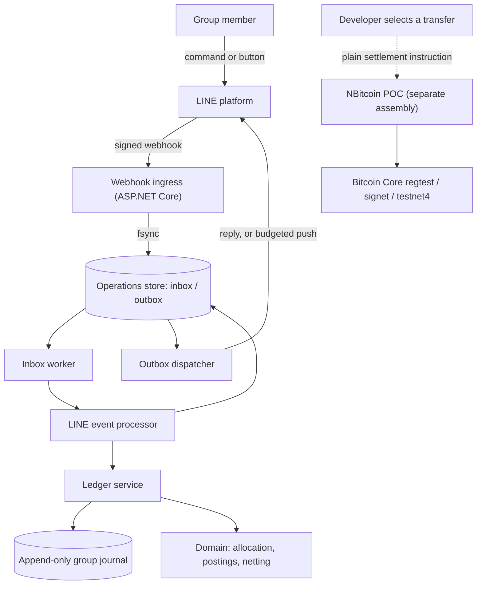
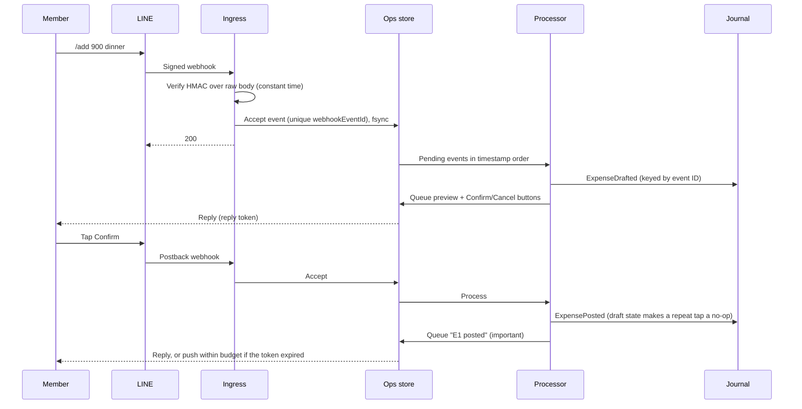
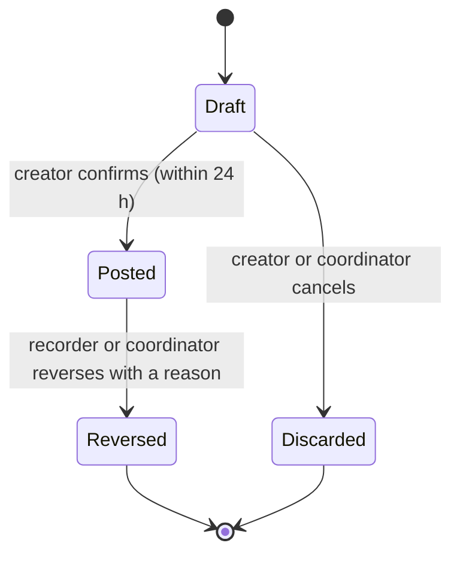
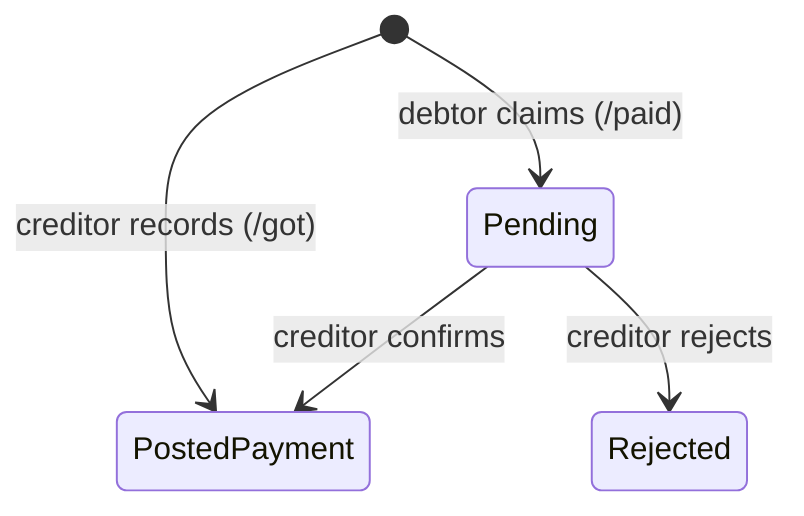
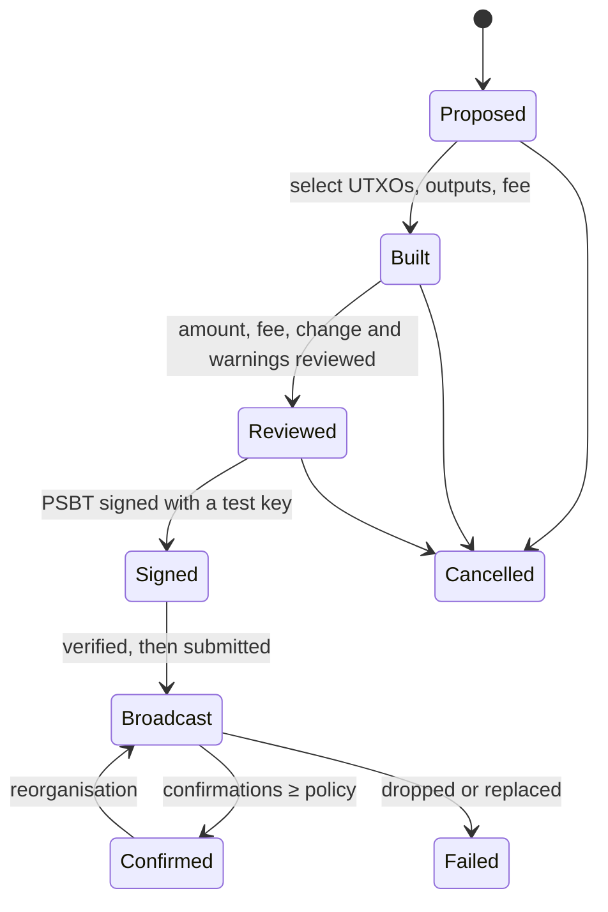

# Maijichain

## User Requirements and Functional Specification

| Field | Value |
|---|---|
| Document version | 1.0, revised after review (v0.9 kept in `docs/archive/`) |
| Product | Maijichain shared-expense application |
| Technology | C# / .NET 10 LTS, ASP.NET Core, LINE Messaging API, NBitcoin 10 |
| Operating context | Private 11-person group |
| Evidence supplied | More than three years of recurring use; 150 transaction cases evaluated (format and runner now defined, §13.3) |
| Intended audience | GitHub visitors, maintainers, and graduate admissions reviewers |

> **Scope and evidence note**
> This document separates the working shared-expense application from the Bitcoin experiment. The LINE-integrated
> expense ledger and balance netting are the operating product described by the project owner. Bitcoin functionality is
> a separate proof of concept on test networks. **Built** marks requirements implemented and tested in this repository
> (the v1.0 rebuild). **Confirmed** marks facts about the historical app. They are kept apart on purpose: a passing test
> in the rebuild says nothing about how the original app behaved.

### Status legend

| Label | Meaning |
|---|---|
| **Confirmed** | Supported by facts about the historical application |
| **Built** | Implemented and covered by automated tests in this repository (v1.0 rebuild) |
| **POC** | Built in the NBitcoin test-network prototype; not production |
| **Roadmap** | Agreed direction, not built |
| **To confirm** | Needs source code, screenshots, or owner confirmation before it is claimed publicly |

### Changes since v0.9

Every change traces to a review finding (`spec-review.md`, R1–R24).

| Area | Change | Review |
|---|---|---|
| Settlement plans | Plans go stale only on balance changes that are not the plan's own payments; staleness is checked when claiming from a plan | R1 |
| Settlement authority | The creditor confirms. Debtor claims stay pending; creditor-recorded receipts post immediately | R2 |
| Rounding | Remainder order rotates per expense key; the v0.9 rule is kept only for replaying legacy data | R3, R21 |
| Netting | Exact minimum-transfer solver for ≤ 20 unsettled members; greedy fallback is labelled | R4 |
| Validation | Amounts too small to give every participant a unit are rejected | R5 |
| Idempotency | Per-command keys plus state-based idempotency (double tap) | R6 |
| LINE delivery | Redelivery is opt-in; reply-first outbox; push budget; retry keys; self-enrolment | R7–R9 |
| Privacy | Hashed LINE identities in the ledger; inbox payload purge; log hygiene | R10, R11 |
| Persistence | Append-only checksummed journal with defined crash and corruption behaviour | R12 |
| Periods | Closed by ledger sequence, not by date | R13 |
| Membership | Leave only at zero balance; returning members keep their ID | R14 |
| Bitcoin POC | regtest/signet/testnet4 only; dust disclosure; deterministic PSBT; own node; social recovery on the roadmap | R15–R17, R22, R23 |
| Platform | .NET 10 LTS; constant-time signature check; explicit currency scale | R18–R20 |
| Evidence | Case-file schema and replay runner for the 150 cases | R24 |

---

## 1. GitHub-ready project summary

Maijichain is a C# shared-expense application built for a private 11-person group. It turns expense commands sent in a
LINE group into an auditable, append-only group ledger, computes each member's net position, and produces the fewest
transfers that settle everyone. The application supported recurring reconciliation for more than three years.

The project also explores how a settlement transfer could become a Bitcoin test-network transaction using NBitcoin. That
prototype is isolated from the expense ledger: the ledger is the source of truth, and the blockchain component
demonstrates PSBT construction, review, signing and confirmation tracking. It does not handle production custody or
mainnet payments.

### Engineering focus

- Exact integer accounting, a zero-sum invariant on every posting, and fair, deterministic rounding.
- Settlement plans that are **provably minimal** for groups of this size and never change anyone's net position.
- Authenticated, idempotent LINE webhook ingestion with asynchronous processing.
- Corrections by reversal: history is never rewritten.
- A Bitcoin adapter that separates building, signing, broadcasting and confirmation, with no path back into the ledger.
- Regression coverage: unit, property-based, contract, end-to-end and regtest tests (§13).

### Project boundary

| In scope | Out of scope |
|---|---|
| Expense capture for a closed group | Banking, card, or fiat-payment execution |
| Equal, exact-amount and weighted allocation (**Built**; historical modes to confirm) | Foreign-exchange conversion and cross-currency netting |
| Per-member balances, explanations and settlement plans | Tax, accounting, or regulatory reporting |
| Settlement recording, confirmation and reconciliation periods | Public multi-tenant operation |
| LINE group interaction | Relying on LINE chat history as the financial record |
| Bitcoin test-network transaction POC | Mainnet funds, investment use, or production key custody |

---

## 2. Problem statement

Long-running friend groups accumulate many small, overlapping obligations. Paying each one separately creates
unnecessary transfers and makes three basic questions hard to answer:

1. What expense was recorded and how was it allocated?
2. What is each person's current net position?
3. What is the smallest set of transfers that clears those positions?

Maijichain turns expenses into balanced ledger entries, aggregates them by member, and generates a deterministic
settlement plan. LINE provides the interaction surface, but the application's journal, not the conversation, is the
authoritative record.

### Product principles

1. **Correct before convenient.** Every posting balances exactly in the currency's minor unit.
2. **One event, one effect.** Redelivery, retries or a double tap never create a second financial effect.
3. **History is explainable.** Corrections reverse or supersede earlier entries; they never rewrite them.
4. **Netting changes payment paths, not economic positions.** Every member's final amount is the same before and after.
5. **Blockchain is an adapter, not the ledger.** A chain outage, reorganisation or fee change cannot affect the expense record.
6. **Fair by construction.** Rounding and tie-breaking rules must not systematically favour or charge the same members. *(new)*

---

## 3. Stakeholders and user roles

| Role | Goal | Principal permissions |
|---|---|---|
| Group member | Record expenses, view balances, pay and confirm payments | Join; create and confirm own drafts; claim payments they made; confirm or reject payments to them; record receipts |
| Expense recorder | Describe who paid and who benefited | Create, confirm and cancel own drafts; reverse own posted expenses |
| Group coordinator | Resolve membership and disputed entries | Everything a member can do; reverse any expense; cancel any draft; close periods; change roles; deactivate members |
| Maintainer | Operate the service without seeing unnecessary personal data | Deploy, monitor, back up, restore, and rotate secrets |
| Test-network participant | Exercise the NBitcoin POC | Provide a test address; review and sign a test PSBT (**POC**) |

The first member to join a group becomes its coordinator. A group always keeps at least one active coordinator.

---

## 4. User requirements

### 4.1 Core requirements

| ID | User requirement | Priority | Status |
|---|---|---:|---|
| UR-01 | A group member shall be able to submit a shared expense from the group's LINE chat. | Must | Confirmed at product level; **Built** |
| UR-02 | An expense shall identify amount, currency, payer, participants, allocation, date and description. | Must | **Built**; historical input fields to confirm |
| UR-03 | A member shall see a preview and explicitly confirm an expense before it affects balances. | Must | **Built** |
| UR-04 | The system shall calculate each member's net position from posted expenses and confirmed settlements. | Must | Confirmed; **Built** |
| UR-05 | The system shall propose the fewest payments that clear all non-zero balances without changing any member's position. | Must | Confirmed (compact plan); **Built** (provably minimal ≤ 20 unsettled members) |
| UR-06 | A member shall be able to view current balances and the entries that explain them. | Must | **Built**; historical to confirm |
| UR-07 | Repeated or redelivered LINE events, and repeated button taps, shall have no duplicate financial effect. | Must | **Built** |
| UR-08 | A mistaken posted expense shall be corrected through a traceable reversal and replacement. | Must | **Built** |
| UR-09 | A payment shall reduce balances only once, and only after the **receiving** member confirms it or records it. | Must | **Built** |
| UR-10 | The group shall be able to use the application across reconciliation periods without losing history. | Must | Confirmed by three-year use; **Built** |
| UR-11 | Unauthorised LINE users and groups shall not be able to read or change a group's ledger. | Must | **Built** |
| UR-12 | The maintainer shall be able to diagnose failures from structured events without exposing message text, LINE identifiers or keys. | Should | **Built** |
| UR-13 | A selected settlement transfer may be turned into a reviewable Bitcoin test-network transaction with NBitcoin. | Could | **POC** |
| UR-14 | No production Bitcoin or fiat funds shall be needed to demonstrate the project. | Must | **POC** boundary |
| UR-15 | Rounding shall not systematically disadvantage the same members over time. | Must | **Built** *(new)* |
| UR-16 | A member shall be able to leave once settled, and to return later with their history intact. | Should | **Built** *(new)* |

### 4.2 Acceptance-level user stories

**US-01 Record an expense.** As a group member, I want to state the amount, what it was for, who paid and who shares it
in LINE, so that the expense reaches everyone's balance after I confirm the preview.

**US-02 Understand a balance.** As a group member, I want a balance to be traceable to individual expenses and payments,
so that I can resolve disagreements without searching chat history.

**US-03 Settle efficiently.** As a group member, I want Maijichain to replace many obligations with the shortest
settlement plan, so that the group makes the fewest transfers.

**US-04 Correct a mistake.** As a recorder or coordinator, I want to reverse an incorrect expense and post its
correction, so that the final balance is right and the reason stays visible.

**US-05 Pay and be acknowledged.** As a debtor, I want to mark a plan transfer as paid; as the creditor, I want to
confirm I received it, so that balances only move when money really arrived. *(new)*

**US-06 Exercise the Bitcoin POC.** As a developer, I want to build, review, sign and broadcast a test-network
transaction from a settlement instruction, so that I can demonstrate UTXO selection, fees, change, PSBT signing and
confirmation tracking without real funds.

---

## 5. System context and architecture



The POC receives a plain settlement instruction (transfer ID, amounts, recipient address). It has no reference to the
ledger assemblies, and an automated test enforces this.

### 5.1 Logical components

| Component | Responsibility | Boundary |
|---|---|---|
| Webhook ingress | Read the raw body (≤ 1 MiB), verify the signature, check `destination`, record each event under its `webhookEventId`, return 200 after fsync | No domain rules; no parsing before verification |
| Operations store | Inbox (de-duplication, pending events), outbox, push-quota log, chat routes; compacted | Operational data only; payloads purged after processing |
| Event processor | Parse a command or postback, resolve the member, run one ledger command, queue one reply | Never writes balances directly |
| Ledger service | Serialise commands per group; append to the journal before applying | One accepted command = one journal record |
| Group ledger (domain) | Validate commands, produce events, apply events, answer queries | Pure; no I/O |
| Debt simplifier | Turn balances into transfers | Pure, deterministic; output verified by replay |
| Outbox dispatcher | Deliver replies; fall back to budgeted push for important messages | Delivery failure never touches the ledger |
| NBitcoin POC | Build, preview, sign, verify and track test transactions | No mainnet; no ledger reference; no secrets in logs |

### 5.2 Processing model



LINE recommends verifying the signature before processing, handling events asynchronously, and using `webhookEventId`
to detect duplicates, because redelivered events can arrive more than once or out of order. Webhook redelivery is
**disabled by default** and must be enabled in the LINE Developers Console; the design does not depend on it.[^line-receive][^line-signature]

---

## 6. Domain model

### 6.1 Core entities

The rebuild is event-sourced. The journal stores **events**, and the entities below are projections rebuilt by replay.

| Entity / event | Required fields | Notes |
|---|---|---|
| `GroupOpened` | `GroupId`, `Name`, `CurrencyCode`, `CurrencyScale`, `RemainderPolicy` | `GroupId` = keyed hash of the LINE chat ID |
| `Member` / `MemberJoined` | `MemberId`, `Nickname`, `IdentityRef`, `Role`, `Active` | `MemberId` is internal and stable (`m001` …). `IdentityRef` = HMAC of the LINE user ID |
| `Draft` / `ExpenseDrafted` | `DraftId`, `Payer`, `Amount`, `Description`, `OccurredOn`, `Shares`, `ExpiresAt`, `CreatedBy` | Expires after 24 h; no balance effect |
| `Expense` / `ExpensePosted` | `ExpenseId`, `DraftId`, `Lines` | Posting lines are stored, and re-checked on replay |
| `ExpenseReversed` | `ExpenseId`, `Reason`, `Lines` | Lines exactly negate the original |
| `Payment` / `PaymentClaimed`, `PaymentPosted`, `PaymentRejected` | `PaymentId`, `From`, `To`, `Amount`, optional `PlanId` + `TransferIndex` | A claim is pending; posting requires the creditor |
| `SettlementPlan` / `PlanCreated` | `PlanId`, `BaseSequence`, `Method`, `Transfers` | `Method` = `ExactMinimum`, `Greedy` or `None` |
| `PeriodClosed` | `PeriodId`, `Label`, `ThroughSequence`, `Balances` | Snapshot at a sequence |
| Every event | `Sequence`, `At`, `Actor`, `SourceKey` | `SourceKey` = idempotency key (usually the `webhookEventId`) |
| Ops: inbox | `EventId`, `EventTimestamp`, `ReceivedAt`, `Payload` | Payload dropped after processing |
| `ChainTransaction` (POC) | `TransferId`, `TxId`, `State`, `Confirmations`, history | Never stores keys or seeds |

Ledger lines are signed: positive means the group owes the member, negative means the member owes the group.

### 6.2 State rules





- A posted expense is immutable. A correction is a reversal, optionally followed by a new expense with a new ID.
- No raw message is stored after processing, so a LINE "unsend" event has nothing to delete. A confirmed record is never
  deleted; the member uses `/undo`.

---

## 7. Monetary model and invariants

### 7.1 Representation

Amounts are `long` integers of the currency's minor unit. The **scale** is explicit group configuration, recorded in
`GroupOpened`. ISO 4217 lists TWD with two decimals, but everyday TWD settlement uses whole dollars, so the default is
TWD with scale 0, and the parser rejects decimals. A scale-2 group is possible. Binary floating point is never used.
Arithmetic is `checked`, and apportionment uses 128-bit intermediates.

### 7.2 Posting an expense

For an expense of amount *A* paid by member *p* with shares *sᵢ*, where Σ *sᵢ* = *A*:

- payer *p*: +*A* (`Paid`)
- each participant *i*: −*sᵢ* (`Share`)

If the payer is also a participant, both lines apply. Every posting sums to zero (INV-01).

### 7.3 Allocation and rounding

| Mode | Command form | Rule |
|---|---|---|
| Equal | `/add 900 dinner` or `@amy @bob` | Weights all 1 |
| Weighted | `@amy*2 @bob` | Largest remainder (Hamilton): floor(*A*·*wᵢ*/*W*), leftover units to the largest fractional remainders |
| Exact | `@amy=600 @bob=400` | Shares must sum exactly to *A* |

Ties between equal fractional remainders, which include every equal split, are broken by member-ID order **rotated by
an offset = SHA-256(group/draft ID) mod n**. The same expense always gives the same shares, and they are shown in the
preview before confirmation, but over many expenses the extra units spread evenly. `RemainderPolicy.FirstByMemberId`
reproduces the v0.9 rule for replaying legacy history. Every share must be at least one minor unit; otherwise the
expense is rejected (`amount.too_small`).

### 7.4 Payments

For a payment of *x* from debtor *d* to creditor *c*: *d* gets +*x* (`PaymentSent`), *c* gets −*x*
(`PaymentReceived`). An overpayment is recorded as it happened and flips the direction of the debt.

### 7.5 Mandatory invariants

| ID | Invariant | Enforced by |
|---|---|---|
| INV-01 | Each posting sums to zero. | `Postings.EnsureBalanced` |
| INV-02 | All balances of a ledger sum to zero. | `BalanceSheet` (every apply) |
| INV-03 | Shares are ≥ 1 minor unit and sum exactly to the amount. | `SplitRule.Allocate` |
| INV-04 | One idempotency key or one draft or payment state change has at most one financial effect. | Source keys + state checks |
| INV-05 | Transfers are positive and between different members. | `Postings.ForPayment`, `DebtSimplifier.VerifySettles` |
| INV-06 | Netting preserves every member's balance (replay clears all). | `DebtSimplifier.VerifySettles` |
| INV-07 | Reversal lines exactly negate the original lines. | `Postings.Reverse` + replay check |
| INV-08 | Different currencies are never netted together. | One ledger = one currency, by construction |
| INV-09 | A transfer cannot be claimed from a plan if the ledger changed since the plan for any reason other than that plan's own payments. | `GroupLedger.IsPlanStale` |
| INV-10 | Journal replay reproduces exactly the posting lines that the rules produce. | `GroupLedger.Apply` |

---

## 8. Balance netting

### 8.1 Goal

Given balances *bᵢ* (positive = receives, negative = pays), emit positive debtor→creditor transfers that bring every
balance to zero, using as few transfers as possible.

### 8.2 Algorithm

The minimum number of transfers for *k* unsettled members is *k* − *p*, where *p* is the largest number of disjoint
**zero-sum groups** the members can be split into: each group of size *m* settles in *m* − 1 transfers. Deciding
whether fewer than *n* − 1 transfers are possible is NP-complete.[^shared-expenses] Exponential in *k* is still tiny for
a friend group, though.

1. Validate that balances sum to zero.
2. If *k* ≤ 20 (**exact**): dynamic programming over the 2^*k* subsets in member-ID order. `dp[mask]` is the maximum
   number of zero-sum cut points along a removal chain. Following the chain gives the maximal partition into zero-sum
   groups.
3. Settle each group with the greedy heap (largest creditor ↔ largest debtor, ties by member ID). Inside a group with no
   smaller zero-sum subset this uses exactly *m* − 1 transfers, which is optimal.
4. If *k* > 20 (**greedy**): apply step 3 to everyone, and report the plan as "simplified, not proven minimal".
5. Verify by replay that every balance becomes zero (FR-NET-05).

Both methods move the same total amount (the sum of credits), because no money passes through an intermediary.

### 8.3 Worked example

| Member | Net position |
|---|---:|
| A | +1,100 TWD |
| B | +200 TWD |
| C | −500 TWD |
| D | −800 TWD |

No proper subset sums to zero, so the minimum is 4 − 1 = 3: D pays A 800, C pays A 300, C pays B 200. With balances
−3, −2, −2, +3, +4 (cents or whole dollars), greedy needs 4 transfers, while the exact method finds {+3, −3} and
{+4, −2, −2} and needs 3.

---

## 9. Functional requirements

### 9.1 LINE ingress and interaction

| ID | Functional requirement | Status |
|---|---|---|
| FR-LINE-01 | Accept webhooks only at `/webhooks/line`, over HTTPS (TLS terminated by the host or a reverse proxy). | **Built** (endpoint); TLS is a deployment step |
| FR-LINE-02 | Compute HMAC-SHA256 over the unmodified raw body with the channel secret; compare with the decoded `x-line-signature` in constant time, before parsing. | **Built** |
| FR-LINE-03 | Reject a missing or invalid signature (401) without storing anything or running a command. | **Built** |
| FR-LINE-04 | Record each event under its unique `webhookEventId` before processing. | **Built** |
| FR-LINE-05 | Treat a duplicate event as a successful no-op. | **Built** |
| FR-LINE-06 | Return 200 only after durable acceptance; process asynchronously. | **Built** |
| FR-LINE-07 | Process pending events in event-timestamp order. The ledger order is the commit sequence. | **Built** |
| FR-LINE-08 | Bind the LINE chat to an internal group and the sender to an active member; ask unknown senders to `/join`. | **Built** |
| FR-LINE-09 | Do not retain raw messages after processing; keep only structured financial data and event IDs. | **Built** |
| FR-LINE-10 | Ignore messages that do not start with `/`, so ordinary group chat is never processed as a command. | **Built** *(new)* |
| FR-LINE-11 | Reply with the free Reply API while the token is fresh. Push only financially important messages, within a monthly budget, with a deterministic `X-Line-Retry-Key`. | **Built** *(new)* |
| FR-LINE-12 | Store only keyed hashes of LINE user and chat IDs in the ledger. Keep the raw chat ID only in the operations store, for push. | **Built** *(new)* |
| FR-LINE-13 | Reject webhooks whose `destination` differs from the configured bot user ID, when one is configured. | **Built** *(new)* |
| FR-LINE-14 | Explain how to allow profile access when LINE omits the sender's user ID. | **Built** *(new)* |

#### Command reference (Built)

| Command | Meaning |
|---|---|
| `/join <nickname>` | Register yourself (first member becomes coordinator) |
| `/add <amount> <what> [@nick … \| @nick=amt … \| @nick*w …] [by:@payer] [date:yyyy-mm-dd]` | Draft an expense (default: everyone, paid by you) |
| Confirm / Cancel buttons, or `/confirm D3`, `/cancel D3` | Post or discard a draft |
| `/bal`, `/bal @nick` | Balances; one member's explained statement |
| `/plan` | Create a settlement plan |
| `/paid S2-1`, `/paid 300 @amy` | Debtor claims a payment (pending) |
| Received / Not received buttons, or `/confirm P4`, `/reject P4 [reason]` | Creditor confirms or rejects |
| `/got 300 @bob` | Creditor records money received (posts immediately) |
| `/undo E7 <reason>` | Reverse an expense |
| `/history [n]`, `/close <label>`, `/help` | Activity, period close (coordinator), help |

Chinese aliases: `/記`, `/記帳`, `/餘額`, `/結算`, `/付`, `/收`, `/確認`, `/取消`, `/加入`, `/說明`. Full-width `／` and `＠` are accepted.

### 9.2 Expense capture

| ID | Functional requirement | Status |
|---|---|---|
| FR-EXP-01 | Create a draft with payer, amount, currency (group's), participants, allocation, date and description. | **Built**; historical form to confirm |
| FR-EXP-02 | Reject unknown or inactive members, non-positive or out-of-range amounts, empty or duplicate participants, and bad descriptions. | **Built** |
| FR-EXP-03 | Support equal, weighted and exact allocation; exact shares must sum to the amount. | **Built** |
| FR-EXP-04 | Show a preview with payer, total, every share and the date before posting. | **Built** |
| FR-EXP-05 | Post the expense, its lines and its audit data as one atomic journal record. | **Built** |
| FR-EXP-06 | Return the expense ID and the updated positions of the members involved. | **Built** |
| FR-EXP-07 | A repeated confirmation (any event) returns the existing outcome. | **Built** |
| FR-EXP-08 | Correct a posted expense only by an authorised reversal (recorder or coordinator) with a reason. | **Built** |
| FR-EXP-09 | Only the draft's creator can confirm it; drafts expire after 24 h. | **Built** *(new)* |

### 9.3 Balance and history

| ID | Functional requirement | Status |
|---|---|---|
| FR-BAL-01 | A member's balance is the sum of their ledger lines. | **Built** |
| FR-BAL-02 | Group balances are read under the group lock, from one consistent sequence. | **Built** |
| FR-BAL-03 | A statement lists the expense and payment references, with running totals. | **Built** |
| FR-BAL-04 | All projections rebuild from the append-only journal on start-up. | **Built** |
| FR-BAL-05 | One ledger, one currency. | **Built** |

### 9.4 Netting and settlement

| ID | Functional requirement | Status |
|---|---|---|
| FR-NET-01 | Accept a complete zero-sum balance sheet for one ledger. | **Built** |
| FR-NET-02 | Return only positive debtor→creditor transfers. | **Built** |
| FR-NET-03 | Produce identical output for identical input, regardless of input order. | **Built** |
| FR-NET-04 | Produce the minimum number of transfers when ≤ 20 members are unsettled, and at most *k* − 1 otherwise; report which. | **Built** |
| FR-NET-05 | Verify the output by replay. | **Built** |
| FR-SET-01 | Save each plan with the sequence it was computed from. | **Built** |
| FR-SET-02 | Refuse to claim a plan transfer when the plan is stale (INV-09); the user creates a new plan. | **Built** |
| FR-SET-03 | Post a payment as a balanced pair of lines in one journal record. | **Built** |
| FR-SET-04 | Make payment confirmation idempotent. | **Built** |
| FR-SET-05 | Debtor claims are pending until the creditor confirms; only the creditor may confirm or reject. | **Built** *(new)* |
| FR-SET-06 | A creditor may record a receipt directly; it posts immediately. | **Built** *(new)* |
| FR-SET-07 | A plan transfer can be claimed once, unless the claim is rejected. | **Built** *(new)* |

### 9.5 Membership and periods

"Recurring" means the group repeatedly used the same reconciliation process for over three years. It does not imply
automatic scheduled expenses.

| ID | Functional requirement | Status |
|---|---|---|
| FR-REC-01 | Preserve all history across periods. | Confirmed; **Built** |
| FR-REC-02 | A coordinator closes a period at the current ledger sequence; the balance snapshot is the next opening balance. | **Built** |
| FR-REC-03 | A closed period's balances can be recomputed and compared with its snapshot. | **Built** |
| FR-REC-04 | Recurring-expense templates only if separately built and tested. | Not claimed |
| FR-MEM-01 | Deactivate a member only at zero balance with no open drafts or pending payments; keep at least one coordinator. | **Built** *(new)* |
| FR-MEM-02 | A returning member keeps their member ID and history. | **Built** *(new)* |

---

## 10. Bitcoin / NBitcoin proof of concept

### 10.1 Purpose and boundary

The POC demonstrates how a settlement transfer maps to a Bitcoin test transaction. It is not the accounting ledger and
does not imply mainnet readiness. Testnet3 is deprecated and removed from Bitcoin Core 30.[^bitcoin-testnets] Use
**regtest** for automated tests, where the test controls block generation,[^bitcoin-testing] and **signet** or
**testnet4** (BIP 94) for public demonstrations. NBitcoin supplies addresses, scripts, PSBT, signing and RPC.[^nbitcoin]
PSBT (BIP 174) separates building from signing.[^bip174]

### 10.2 POC flow



### 10.3 Functional requirements

| ID | Functional requirement | Status |
|---|---|---|
| FR-BTC-01 | Accept only a settlement transfer explicitly selected for the POC, as a plain instruction (no ledger reference). | **POC** |
| FR-BTC-02 | Require an explicit network (`regtest`, `signet`, `testnet4`); refuse mainnet and testnet3; refuse addresses and WIF keys from another network. | **POC** |
| FR-BTC-03 | Convert to satoshis only through an explicit, labelled test rate or amount; no exchange-rate service. | **POC** |
| FR-BTC-04 | Select spendable UTXOs and check inputs = recipient + change + fee. | **POC** |
| FR-BTC-05 | Preview recipient, amount, inputs, fee rate, absolute fee, virtual size, change and warnings before signing. | **POC** |
| FR-BTC-06 | Send change to a test change address. If change would be dust, disclose the amount added to the fee and require manual review. | **POC** |
| FR-BTC-07 | Build an unsigned PSBT separately from signing; sign only a reviewed proposal. | **POC** |
| FR-BTC-08 | Keep seeds, private keys, WIF values and tokens out of source control and logs. | **POC** (no persistence or logging of keys) |
| FR-BTC-09 | Before broadcast, check that the signed transaction is exactly the reviewed one, is script-valid and is within fee policy. | **POC** |
| FR-BTC-10 | Record the TxId and state; zero confirmations is never final. | **POC** |
| FR-BTC-11 | Rejection, replacement or reorganisation changes only the POC state, never the expense ledger. | **POC** (enforced by assembly isolation) |
| FR-BTC-12 | Run the full lifecycle on regtest in automated tests; use public test networks only for demos. | **POC** (verified against Bitcoin Core v32.1 regtest) |
| FR-BTC-13 | Social key recovery: a Bitcoin-native recovery path (e.g. miniscript `or(pk(owner), and(thresh(k, friends…), older(N)))`) rather than reassembling a seed on one device; tested on regtest. | **Roadmap** |
| FR-BTC-14 | PSBT construction is deterministic per transfer ID (seeded output and coin shuffling). | **POC** *(new)* |

Bitcoin transactions spend UTXOs and return the surplus through a change output; any difference between inputs and
outputs is the fee.[^bitcoin-transactions]

### 10.4 Security exclusions

- No mainnet network, address or key is accepted.
- No seed, private key, WIF, channel secret or access token is committed to Git.
- No endpoint returns key material; the web host does not reference the POC at all.
- Test keys are disposable and separate from any wallet that has held real value.
- A test transaction ID may be published; its keys may not.

---

## 11. Non-functional requirements

| ID | Quality | Requirement / acceptance condition | Status |
|---|---|---|---|
| NFR-01 | Correctness | All invariants hold for every command, fixture and property-test run. | **Built** |
| NFR-02 | Determinism | Same ledger → identical settlement output; same expense → identical shares; same transfer → identical PSBT. | **Built** |
| NFR-03 | Reliability | Redelivery, retry, double tap or worker restart cannot duplicate a financial effect. | **Built** |
| NFR-04 | Atomicity | One command = one fsynced journal record; a torn final write is discarded on recovery; other corruption stops the load. | **Built** |
| NFR-05 | Auditability | Every event records actor, time, idempotency key and, for reversals, a reason. | **Built** |
| NFR-06 | Security | Constant-time signature check before parsing; secrets from configuration only; startup fails without them. | **Built** |
| NFR-07 | Privacy | Hashed identities; payload purge; anonymised public fixtures. | **Built** |
| NFR-08 | Performance | Netting for ≤ 20 unsettled members completes in well under a second; no network calls inside the ledger lock. | **Built** |
| NFR-09 | Recoverability | Restoring the journal files restores all balances, drafts, plans and idempotency keys. | **Built** |
| NFR-10 | Observability | Logs carry event IDs, outcomes, counts and error types, never message text or LINE IDs. | **Built** |
| NFR-11 | Maintainability | Domain, application, persistence, LINE, host and POC are separate projects; dependency rules are tested. | **Built** |
| NFR-12 | Testability | Domain and ledger tests need no LINE or network; the regtest test is opt-in. | **Built** |
| NFR-13 | Platform | .NET 10 LTS (support to Nov 2028). .NET 8 and 9 ended support on 2026-11-10.[^dotnet] | **Built** *(new)* |
| NFR-14 | Cost | Stay within the free LINE message plan in normal use (reply-first, push budget).[^line-price] | **Built** *(new)* |

---

## 12. Error handling

| Condition | User-visible response | System behaviour |
|---|---|---|
| Invalid or missing signature | None (HTTP 401) | Nothing stored |
| Wrong `destination` | None (HTTP 401) | Nothing stored |
| Malformed body or missing event ID | None (HTTP 400) | Nothing stored |
| Duplicate event | Original outcome (or nothing) | No-op |
| Ordinary chat message | None | Event recorded, then purged |
| Unknown sender | "Please join first: /join <nickname>" | No ledger write |
| No user ID from LINE | How to allow profile access | No ledger write |
| Shares do not equal total | Total and difference | No draft |
| Amount too small to split | Explanation | No draft |
| Draft expired or cancelled | "Please enter it again" | No posting |
| Not authorised (e.g. confirming someone else's payment) | Who may do it | No ledger write |
| Stale plan | "Create a new plan" | No claim |
| Invariant failure | Generic message | Command rejected; nothing appended |
| Journal checksum failure mid-file | Service does not start that group | Requires restore from backup |
| Reply fails after commit | Important messages pushed within budget | Ledger unaffected |
| Insufficient test UTXOs | "Not enough confirmed test coins" | No signing |
| Excessive fee or dust change | Warning; manual review required | Not signed automatically; broadcast refused if over fee policy |
| Broadcast rejected or dropped | POC state Failed | Ledger unaffected |

---

## 13. Test strategy

### 13.1 Test layers (Built)

| Layer | Project | Focus |
|---|---|---|
| Domain unit tests | `Maijichain.Domain.Tests` | Allocation, rounding, postings, ledger rules, netting |
| Property-based tests | same | Zero-sum, replay, determinism, optimality against a brute-force oracle, fairness of rounding |
| Case corpus | same + `tests/fixtures` | Data-driven replay of `*.cases.json` files |
| Persistence | `Maijichain.Integration.Tests` | Round-trip of every event type, restart, torn write, corruption, concurrency, compaction |
| LINE contract | same | Signature, parser, receiver, redelivery, client status mapping, message limits |
| End-to-end | same | Webhook → inbox → processor → journal → outbox; real Kestrel host; log privacy |
| Architecture | same + POC tests | Dependency rules (ledger never references Bitcoin; POC never references the ledger) |
| NBitcoin offline | `Maijichain.BitcoinPoc.Tests` | Networks, PSBT, conservation, dust, fees, signing, guard, tracker |
| NBitcoin regtest | same (opt-in) | Mine → build → sign → broadcast → confirm against Bitcoin Core |

### 13.2 Representative acceptance cases

| Test ID | Scenario | Expected result | Test |
|---|---|---|---|
| TC-001 | 100 TWD split among 3 | Shares {34, 33, 33}, sum 100, identical on every run | `TC001_…`, corpus TC-001 |
| TC-002 | Payer is a participant | Payer receives amount − own share; posting sums to zero | `TC002_…` |
| TC-003 | Payer is not a participant | Payer receives the full amount | `TC003_…` |
| TC-004 | Exact shares sum to 999 of 1,000 | Rejected; no draft | `TC004_…`, corpus |
| TC-005 | Same `webhookEventId` delivered twice | One accepted event, one effect | `TC005_…` (domain + receiver) |
| TC-006 | Confirm tapped twice | One expense; second tap returns the existing outcome | `TC006_…`, pipeline |
| TC-007 | Posted expense corrected | Original visible; reversal negates; replacement has a new ID | `TC007_…`, corpus |
| TC-008 | Circular obligations | No transfer | `TC008_…`, corpus |
| TC-009 | 11 members, all non-zero | Cleared in ≤ 10 transfers | `TC009_…`, corpus |
| TC-010 | Equal magnitudes | Stable member-ID tie-break | `TC010_…` |
| TC-011 | Ledger changes after plan creation | Claim from the old plan refused; the plan's own payments do not make it stale | `TC011_…`, pipeline, corpus |
| TC-012 | Redelivery or re-processing after a crash | No duplicate or negative effect | `TC012_…` |
| TC-013 | Address on the wrong network | Refused before building | `TC013_…` |
| TC-014 | UTXO exceeds amount + fee | Explicit change; conservation holds | `TC014_…` |
| TC-015 | Broadcast with 0 confirmations | State `Broadcast`, not `Confirmed` | `TC015_…`, regtest |
| TC-016 | Balances −3, −2, −2, +3, +4 | Exact plan uses 3 transfers (greedy: 4) | `Greedy_is_not_always_minimal…`, corpus NET-001 |
| TC-017 | 3,000 equal splits among 11 | Each member's rounding units within ±15 % of the mean | `Rotation_spreads…` |
| TC-018 | Debtor claims, creditor rejects, then confirms a new claim | Balances move once, only on creditor confirmation | corpus SET-002, `Debtor_claim…` |
| TC-019 | Journal record edited on disk | Load refuses with a corruption error | `Edited_record_is_detected_as_corruption` |
| TC-020 | Crash leaves a half-written final record | Discarded with a warning; next append overwrites it | `Torn_final_write_…` |

### 13.3 The 150-case evidence

The case-file schema is in `tests/fixtures/transaction-cases/README.md`. Every `*.cases.json` file in that folder is
replayed by `CaseCorpusTests`. Each case checks expected balances, expected error codes, plan size, zero-sum after every
step, and replay equality. The repository ships **15 synthetic cases**. Before the "150 transaction cases" claim is
published:

1. Anonymise the historical cases into the same format (member IDs only, generic descriptions).
2. State whether they are historical records, manual scenarios or automated cases, with counts by category.
3. Publish the run summary (`docs/test-report.md`) with the commit hash and date.

---

## 14. Requirements traceability

| User requirement | Functional requirements | Primary tests |
|---|---|---|
| UR-01, UR-02, UR-03 | FR-LINE-08/10; FR-EXP-01–09 | TC-001–006, `CommandParserTests`, `Expense_flow_…` |
| UR-04, UR-06 | FR-BAL-01–05 | TC-002/003, `Statement_explains_the_balance`, `Replay_rebuilds_identical_state` |
| UR-05 | FR-NET-01–05 | TC-008–010, TC-016, netting property test |
| UR-07 | FR-LINE-04–07; FR-EXP-07; FR-SET-04 | TC-005, TC-006, TC-012 |
| UR-08 | FR-EXP-08 | TC-007 |
| UR-09 | FR-SET-01–07 | TC-011, TC-018 |
| UR-10 | FR-REC-01–03 | `Closing_a_period_…`, restart tests |
| UR-11 | FR-LINE-02/03/08/13 | Signature and receiver tests, host 401 test |
| UR-12 | NFR-07, NFR-10; FR-LINE-09/12 | `Logs_never_contain_…`, `Ledger_never_stores_raw_line_ids_…` |
| UR-13, UR-14 | FR-BTC-01–14 | TC-013–015, regtest end-to-end |
| UR-15 | §7.3 | TC-017 |
| UR-16 | FR-MEM-01/02 | `Members_leave_only_when_settled_…` |

---

## 15. GitHub publication plan

### 15.1 Repository structure (as built)

```text
MaijiChain/
├── README.md
├── Maijichain.slnx · global.json · Directory.Build.props · .editorconfig · .gitignore · .env.example
├── .github/workflows/ci.yml
├── docs/
│   ├── requirements-and-functional-specification.md   (this file)
│   ├── spec-review.md
│   ├── architecture.md
│   ├── test-report.md
│   └── archive/requirements-and-functional-specification-v0.9.md
├── src/
│   ├── Maijichain.Domain/         pure rules: allocation, postings, netting, GroupLedger
│   ├── Maijichain.Application/    LedgerService + ports
│   ├── Maijichain.Persistence/    checksummed journals, operations store
│   ├── Maijichain.Line/           signature, receiver, parser, processor, replies, outbox
│   ├── Maijichain.WebHost/        ASP.NET Core endpoint + workers
│   └── Maijichain.BitcoinPoc/     NBitcoin PSBT POC (isolated)
└── tests/
    ├── Maijichain.Domain.Tests/
    ├── Maijichain.Integration.Tests/
    ├── Maijichain.BitcoinPoc.Tests/
    └── fixtures/transaction-cases/
```

### 15.2 Evidence that strengthens the page

- A 30–60 second sanitised LINE GIF: `/add` → preview → Confirm → `/plan` → `/paid` → Received.
- The worked example (§8.3) and the greedy-vs-exact counterexample, both asserted by tests.
- The anonymised 150-case summary (§13.3).
- A regtest or signet transaction ID from disposable keys.
- A short "design decisions" section: idempotency layers, rotation rounding, exact netting, and why the chain is an adapter.

### 15.3 Never publish

- LINE channel secret, access token or identity pepper.
- Raw LINE user or group IDs, or unmasked screenshots.
- Bitcoin seeds, private keys, WIF values, wallet backups or RPC credentials.
- Journal or operations files (`data/` is git-ignored).
- Real names and historical descriptions without every participant's consent.
- A claim of production mainnet use, or of 150 automated tests, unless the evidence supports it.

---

## 16. Facts to confirm before calling anything "as-built" for the historical app

1. The exact LINE interaction: free text, menu, Flex Message, LIFF, or another flow?
2. Which allocation modes the original supported.
3. Where the original ledger was stored, and whether corrections and settlements were immutable entries.
4. What "150 transaction cases" means: test cases, historical records, or both.
5. Which NBitcoin operations the original POC completed, and whether it used QBitNinja for UTXOs or broadcasting.
6. Which Bitcoin network the original used (testnet3, testnet4, signet or regtest).
7. Whether historical data should be migrated by replaying it with `RemainderPolicy.FirstByMemberId`.
8. Whether the public repository may include source code, or should be documentation plus a sanitised demo.

---

## 17. Research basis

- LINE webhook authentication, asynchronous processing, opt-in redelivery, duplicates and ordering.[^line-receive][^line-signature]
- LINE Official Account pricing in Taiwan (reply free; 200 free messages on the light plan; per-recipient counting).[^line-price]
- Shared-expense settlement complexity and zero-sum partitioning.[^shared-expenses]
- NBitcoin primitives; PSBT; Bitcoin test networks; UTXO fees and change.[^nbitcoin][^bip174][^bitcoin-testnets][^bitcoin-testing][^bitcoin-transactions]
- .NET support lifecycle.[^dotnet]

[^line-receive]: LINE Developers, [Receive messages (webhook)](https://developers.line.biz/en/docs/messaging-api/receiving-messages/).
[^line-signature]: LINE Developers, [Verify webhook signature](https://developers.line.biz/en/docs/messaging-api/verify-webhook-signature/).
[^line-price]: LINE Biz-Solutions Taiwan, [2026 LINE Official Account price plans](https://tw.linebiz.com/column/LINEOA-2026-Price-Plan/); Alibaba Cloud, [LINE channel FAQ](https://help.aliyun.com/en/chatapp/user-guide/line-channel-faq).
[^shared-expenses]: X. Bultel, J. Dreier, J.-G. Dumas, P. Lafourcade, [*A Cryptographer's Conspiracy Santa*](https://drops.dagstuhl.de/storage/00lipics/lipics-vol100-fun2018/LIPIcs.FUN.2018.13/LIPIcs.FUN.2018.13.pdf), FUN 2018, §2, Thm 4; T. Verhoeff, [*Settling Multiple Debts Efficiently*](https://infedu.vu.lt/journal/INFEDU/article/612/file/pdf), 2004; [arXiv:1402.6556](https://arxiv.org/abs/1402.6556).
[^nbitcoin]: MetacoSA, [NBitcoin](https://github.com/MetacoSA/NBitcoin) (10.0.21, Nov 2026).
[^bip174]: [BIP 174: Partially Signed Bitcoin Transaction Format](https://bips.dev/174/).
[^bitcoin-testnets]: [BIP 94: Testnet 4](https://bips.dev/94/); [Bitcoin testnet guide](https://www.spark.money/tools/bitcoin-testnet-faucet-guide).
[^bitcoin-testing]: Bitcoin Developer Documentation, [Testing Applications](https://developer.bitcoin.org/examples/testing.html).
[^bitcoin-transactions]: Bitcoin Developer Documentation, [Transactions: fees and change](https://developer.bitcoin.org/devguide/transactions.html#transaction-fees-and-change).
[^dotnet]: .NET Blog, [.NET 8 and .NET 9 will reach End of Support on November 10, 2026](https://devblogs.microsoft.com/dotnet/dotnet-8-9-end-of-support/).
